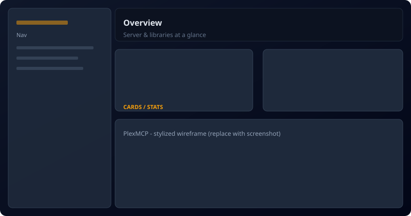
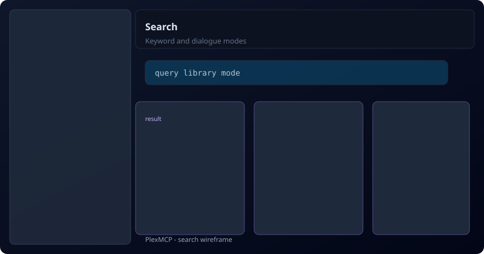
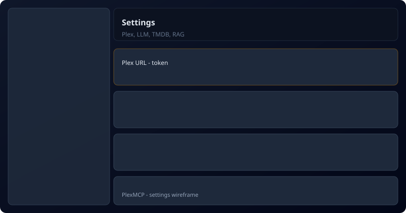

# Webapp

The **FastAPI** backend (port **10740**) loads PlexMCP tools in-process and exposes REST under `/api/*`. It mounts the same FastMCP app at **`/mcp`**. The **Next.js** frontend (port **10741**) is the browser UI.

See also [**ARCHITECTURE.md**](ARCHITECTURE.md), [**SELF_HOSTING.md**](SELF_HOSTING.md), and the [**documentation hub**](README.md).

## Documentation

- **[webapp/README.md](../webapp/README.md)** — stack, features, API overview
- **[webapp/SETUP.md](../webapp/SETUP.md)** — environment and startup

## Ports

Allocated in the fleet range per [mcp-central-docs WEBAPP_PORTS](https://github.com/sandraschi/mcp-central-docs/blob/main/docs/operations/WEBAPP_PORTS.md): **10740** backend, **10741** frontend.

## Quick start

```powershell
cd webapp
# Configure webapp\backend\.env (PLEX_TOKEN, PLEX_URL, optional LLM)
powershell -ExecutionPolicy Bypass -File .\start.ps1
```

Open `http://127.0.0.1:10741`. API docs: `http://127.0.0.1:10740/docs`.

## Screenshots (stylized wireframes)

Real pixels may differ as the UI evolves. These **SVG** previews document the main surfaces:

| Area | Preview |
|------|--------|
| **Overview** (dashboard / server) |  |
| **Search** (keyword or dialogue) |  |
| **Settings** (Plex, LLM, RAG) |  |

Replace with PNGs if you need marketing shots — see [assets/README.md](assets/README.md).

## Diagnostics

**Settings → Diagnostics** runs every connectivity check at once — Plex, LLM provider, RAG index, *arr stack — as a single traffic-light list, instead of hunting through separate pages to find which one is actually broken. Re-check on demand.

## *arr integration

Optional Radarr/Sonarr/Lidarr URLs and API keys in **Settings** power the Overview *arr card and the `arr_stack` MCP tool (read-only status + queue counts). Typical setups use Docker media stacks; use the base URL reachable from the backend.

## Taste

**`/taste`** shows what you gravitate toward and what you pass over, learned from your Plex watch history. A score is *lift against your library* in [-1, 1]: positive = you pick it more than its share of what's available, negative = it's there but you skip it. Movies and TV are separate (different populations), and you can narrow to a time of week ("Sunday mornings") or one family (genres, decades, directors...). A "Lately" panel shows which genres are moving. First visit: **Build my profile** reads your whole history in the background (a couple of minutes on a large library); afterwards **Update from latest viewing** folds in new views, and the backend does it every 10 minutes by itself (`TASTE_SYNC_INTERVAL_SEC`). Hover a row for the numbers behind it. See `docs/plans/TASTE_MODELLING.md`.

## Deep enrichment

- **`/media?ratingKey=...`** — a book-like dossier for one library item: synopsis, critical overview, "why this matters," content warnings, thematic tags (clickable), and "Related in your library" (by director, shared cast, collection, or theme). Opened via "Full dossier" on a movie's detail modal. "Enrich now" fetches Wikipedia + TMDB (deep) + JustWatch and, if an LLM provider/model is picked, synthesises the dossier; without one, it shows the raw sources instead.
- **`/enrichment`** — enriched-item count, stale (>90 day) count, a bulk-enrichment launcher (library + max items + optional LLM provider/model) with live progress, and theme search. Bulk runs as a background job; one at a time.
- Sources: Wikipedia + TMDB (deep) + JustWatch only — see `docs/plans/DEEP_METADATA_ENRICHMENT.md` for why Letterboxd/IMDB/Rotten Tomatoes/Metacritic scraping was deliberately left out.
